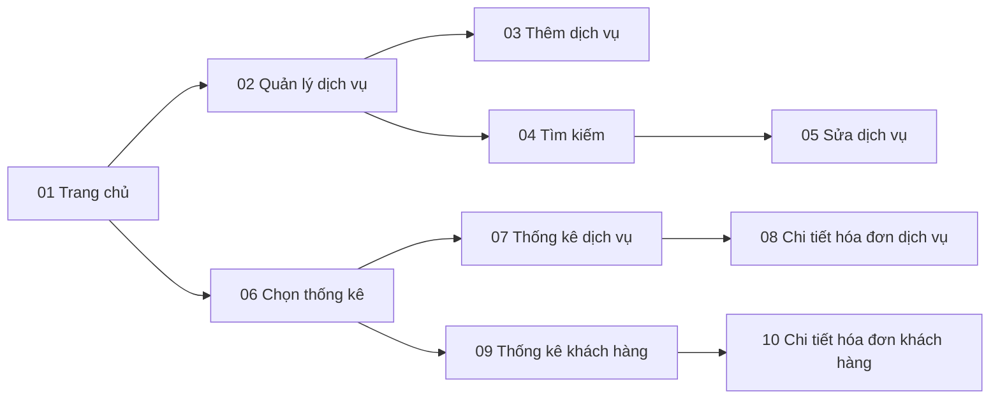

# 04 - Wireframes

Wireframe mức thấp (low-fidelity) của module Quản lý dịch vụ & Báo cáo thống kê.
Ảnh dựa trên thiết kế giao diện của nhóm; các màn thống kê được bổ sung dữ liệu mẫu và
chú thích để đối chiếu use case. *(Ảnh đang được bổ sung.)*

## Danh sách màn hình

| # | Màn hình | UC | US | Ghi chú hành vi | Ảnh |
|---|---|---|---|---|---|
| 01 | Trang chủ Manager | Tất cả | US10 | Hai mục: Quản lý dịch vụ, Xem báo cáo | Đang bổ sung |
| 02 | Quản lý dịch vụ | UC01-03 | US01-03 | Ba nút: Thêm, Sửa, Xóa | Đang bổ sung |
| 03 | Thêm dịch vụ | UC01 | US01 | Status là danh sách chọn; trường bắt buộc theo BR02 | Đang bổ sung |
| 04 | Tìm kiếm dịch vụ | UC02, UC03 | US04 | Tìm theo mã hoặc tên (BR08); hiện mọi trạng thái; dùng chung cho Sửa và Xóa | Đang bổ sung |
| 05 | Sửa dịch vụ | UC02 | US02 | ID bị khóa (BR01); Status là danh sách chọn | Đang bổ sung |
| 06 | Chọn loại thống kê | UC04, UC05 | US05, US07 | Hai nút: Dịch vụ, Khách hàng | Đang bổ sung |
| 07 | Thống kê dịch vụ | UC04 | US05 | Mẫu: 450.000 / 200.000, giảm dần (BR12) | Đang bổ sung |
| 08 | Chi tiết hóa đơn dịch vụ | UC04 | US06 | Cột Amount là Thành tiền dịch vụ; tổng khớp doanh thu (BR13) | Đang bổ sung |
| 09 | Thống kê khách hàng | UC05 | US07 | Mẫu: 350.000 / 300.000 | Đang bổ sung |
| 10 | Chi tiết hóa đơn khách hàng | UC05 | US08 | Cột Amount là Tổng tiền hóa đơn | Đang bổ sung |

## Thông báo hệ thống

| Tình huống | Thông báo | Rule |
|---|---|---|
| Thiếu trường bắt buộc | "Điền đầy đủ thông tin" | BR02 |
| Giá không hợp lệ | "Dữ liệu không hợp lệ" | BR03 |
| Mã trùng | "Dịch vụ đã tồn tại" | BR04 |
| Xác nhận xóa | "Xác nhận xóa dịch vụ" (Xác nhận / Hủy) | BR05 |
| Xóa dịch vụ đã dùng | "Dịch vụ đã có lịch sử sử dụng nên được chuyển sang Ngừng hoạt động" | BR05 |
| Thao tác thành công | "Thêm / Cập nhật / Xóa dịch vụ thành công" | BR15 |
| Ngày sai | "Ngày tháng không hợp lệ" | BR11 |
| Khoảng thời gian sai | "Khoảng thời gian không hợp lệ" | BR11 |
| Không có kết quả | "Không có dịch vụ nào trong kết quả tìm kiếm" / "Không có dữ liệu thống kê" | BR16 |

## Luồng điều hướng

## Quy ước

- Wireframe mức thấp: thể hiện bố cục và thành phần, chưa phải thiết kế giao diện hoàn chỉnh.
- Trường bắt buộc đánh dấu `*`; trường bị khóa (mã dịch vụ khi sửa) nền xám.
- Dữ liệu trong bảng lấy từ [bộ dữ liệu mẫu](../05-data/sample-data.sql).
