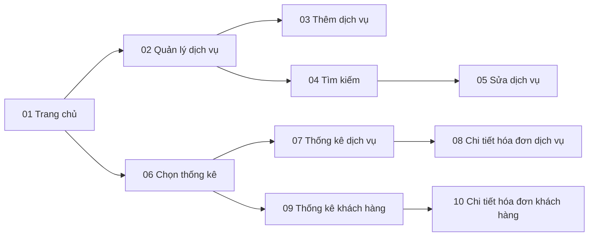

# 04 - Wireframes

Wireframe mức thấp (low-fidelity) của module Quản lý dịch vụ & Báo cáo thống kê.
Ảnh dựa trên thiết kế giao diện của nhóm; các màn thống kê được bổ sung dữ liệu mẫu và
chú thích để đối chiếu use case. *(Ảnh đang được bổ sung.)*

## Danh sách màn hình

| # | Màn hình | UC | US | Ghi chú hành vi | Ảnh |
|---|---|---|---|---|---|
| 01 | Trang chủ Manager | Tất cả | US09 | Hai mục: Quản lý dịch vụ, Xem báo cáo | [01-home.png](screens/01-home.png) |
| 02 | Quản lý dịch vụ | UC01-UC02 | US01-US02 | Hai nút: Thêm, Chỉnh sửa | [02-manage-service.png](screens/02-manage-service.png) |
| 03 | Thêm dịch vụ | UC01 | US01 | Status là danh sách chọn; trường bắt buộc theo BR02 | [03-add-service.png](screens/03-add-service.png) |
| 04 | Tìm kiếm dịch vụ | UC02 | US03 | Tìm theo mã hoặc tên (BR07); hiện mọi trạng thái; dùng cho chức năng Sửa | [04-search-service.png](screens/04-search-service.png) |
| 05 | Sửa dịch vụ | UC02 | US02 | ID bị khóa (BR01); Status là danh sách chọn | [05-update-service.png](screens/05-update-service.png) |
| 06 | Chọn loại thống kê | UC03, UC04 | US04, US06 | Hai nút: Dịch vụ, Khách hàng | [06-select-report.png](screens/06-select-report.png) |
| 07 | Thống kê dịch vụ | UC03 | US04 | Mẫu: 450.000 / 200.000, giảm dần (BR11) | [07-service-statistics.png](screens/07-service-statistics.png) |
| 08 | Chi tiết hóa đơn dịch vụ | UC03 | US05 | Cột Amount là Thành tiền dịch vụ; tổng khớp doanh thu (BR12) | [08-service-bill-detail.png](screens/08-service-bill-detail.png) |
| 09 | Thống kê khách hàng | UC04 | US06 | Mẫu: 350.000 / 300.000 | [09-client-statistics.png](screens/09-client-statistics.png) |
| 10 | Chi tiết hóa đơn khách hàng | UC04 | US07 | Cột Amount là Tổng tiền hóa đơn | [10-client-bill-detail.png](screens/10-client-bill-detail.png) |

## Thông báo hệ thống

| Tình huống | Thông báo | Rule |
|---|---|---|
| Thiếu trường bắt buộc | "Điền đầy đủ thông tin" | BR02 |
| Giá không hợp lệ | "Dữ liệu không hợp lệ" | BR03 |
| Mã trùng | "Dịch vụ đã tồn tại" | BR04 |
| Thao tác thành công | "Thêm / Cập nhật dịch vụ thành công" | BR14 |
| Ngày sai | "Ngày tháng không hợp lệ" | BR10 |
| Khoảng thời gian sai | "Khoảng thời gian không hợp lệ" | BR10 |
| Không có kết quả | "Không có dịch vụ nào trong kết quả tìm kiếm" / "Không có dữ liệu thống kê" | BR15 |

## Luồng điều hướng

## Quy ước

- Wireframe mức thấp: thể hiện bố cục và thành phần, chưa phải thiết kế giao diện hoàn chỉnh.
- Trường bắt buộc đánh dấu `*`; trường bị khóa (mã dịch vụ khi sửa) nền xám.
- Dữ liệu trong bảng lấy từ [bộ dữ liệu mẫu](../05-data/sample-data.sql).
