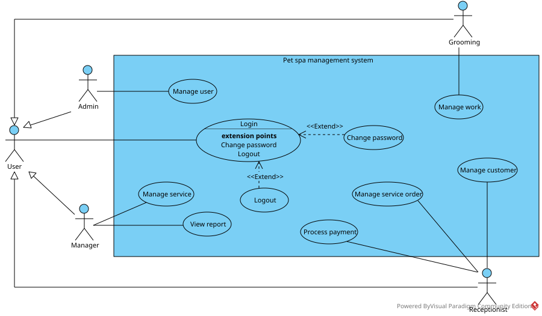

# Pet Spa Management: System Analysis & Service/Report Module
### Phân tích, thiết kế toàn hệ thống spa thú cưng nội bộ và đặc tả chi tiết module Quản lý dịch vụ & Báo cáo thống kê

| | |
|---|---|
| **Loại project** | Requirements specification (bài tập lớn nhóm, PTIT) |
| **Vai trò** | Phân tích, thiết kế mức toàn hệ thống; đặc tả chi tiết module Manager |
| **Công cụ** | Visual Paradigm, MySQL, GitHub |

---

## 1. Bối cảnh và vấn đề

Spa thú cưng nội bộ có nhiều vai trò làm việc song song (quản lý, lễ tân, nhân viên chăm sóc,
quản trị hệ thống). Khi chưa có hệ thống tập trung, người quản lý khó kiểm soát danh mục dịch vụ
và bảng giá, khó biết dịch vụ hay khách hàng nào mang lại doanh thu, và phải tổng hợp doanh thu
thủ công từ hóa đơn.

*(Bối cảnh là giả định từ mục đích hệ thống, chưa qua phỏng vấn người dùng thực tế.)*

## 2. Phạm vi đóng góp

Đây là bài tập lớn nhóm. Tôi thực hiện hai tầng:

1. **Toàn hệ thống** (lấy yêu cầu, phân tích, thiết kế): 4 vai trò kế thừa User, 10 use case,
   lớp thực thể, ERD 10 bảng. Đây là phần nền để nhóm chia module.
2. **Module Quản lý dịch vụ & Báo cáo thống kê** (vai trò Manager): đặc tả chi tiết, kịch bản kiểm thử.

Các module còn lại (Admin, Lễ tân, Chăm sóc, Login) do các thành viên khác phân tích chi tiết và cài đặt.

*Hai use case Manage service và View report (tô nổi bật) là module được đặc tả chi tiết.*

## 3. Đóng góp của tôi

- Phân tích yêu cầu toàn hệ thống, xác định actor, mô hình hóa 10 use case
- Trích lớp thực thể, thiết kế ERD 10 bảng và mịn hóa mô hình dữ liệu
- Viết **15 business rules** và **9 user stories** kèm acceptance criteria cho module Manager
- Đặc tả **4 use case** với luồng chính và luồng ngoại lệ
- Viết data dictionary, schema và dữ liệu mẫu chạy được trên MySQL
- Thiết kế **31 kịch bản kiểm thử nghiệm thu** và ma trận truy vết BR - US - UC - TC
- Đề xuất **10 hướng cải tiến** cho phiên bản sau
- Phát hiện và thống nhất các mâu thuẫn giữa kịch bản, test case và sơ đồ (xem mục 5)

## 4. Phạm vi module chi tiết

| Trong phạm vi | Ngoài phạm vi |
|---|---|
| Thêm / sửa dịch vụ | Đặc tả chi tiết các module khác |
| Tìm kiếm dịch vụ | Đặt/hủy lịch hẹn, thông tin spa |
| Thống kê doanh thu theo dịch vụ | Giảm giá, phụ thu |
| Thống kê doanh thu theo khách hàng | Xuất báo cáo, biểu đồ |

## 5. Các quyết định phân tích đáng chú ý

| Quyết định | Lý do |
|---|---|
| **Giá chụp lại** trong chi tiết đơn tại thời điểm sử dụng | Sửa giá không làm đổi doanh thu quá khứ (BR05) |
| Doanh thu dịch vụ = Σ(số lượng × giá); khách hàng = Σ tiền hóa đơn | Một hóa đơn gồm nhiều dịch vụ; khách hàng dùng tiền thực thu (BR09) |
| Cột chi tiết hóa đơn đổi thành **"Thành tiền dịch vụ"** | Tổng chi tiết khớp doanh thu thống kê, đối chiếu được (BR12) |
| Lọc kỳ theo ngày thanh toán, nửa khoảng `[bắt đầu, kết thúc + 1)` | `paymentDay` là timestamp; `BETWEEN` bỏ sót hóa đơn cuối ngày cuối kỳ (BR08) |

**Mâu thuẫn đã phát hiện và xử lý khi viết lại tài liệu nhóm:** số liệu tiền không khớp giữa
kịch bản và bảng; test báo cáo có dữ liệu
nhưng mong đợi "không có dữ liệu"; lỗi tên phương thức trong sơ đồ; ERD thiếu vai trò, v.v.

## 6. Mục lục tài liệu

| Thư mục | Nội dung |
|---|---|
| [01-business-context](01-business-context/) | Vấn đề, stakeholder, phạm vi, tổng quan hệ thống |
| [02-requirements](02-requirements/) | Business rules, user stories, NFR, glossary, ma trận truy vết |
| [03-use-cases](03-use-cases/) | Sơ đồ và đặc tả 4 use case |
| [04-wireframes](04-wireframes/) | Thiết kế giao diện |
| [05-data](05-data/) | ERD, data dictionary, schema, dữ liệu mẫu, truy vấn kiểm chứng |
| [06-uat-scenarios](06-uat-scenarios/) | 31 kịch bản kiểm thử nghiệm thu |
| [appendix-technical](appendix-technical/) | Sơ đồ lớp, sơ đồ tuần tự (phụ lục) |

**Chạy thử số liệu:** `05-data/schema.sql` → `sample-data.sql` → `report-queries.sql`; kết quả khớp
use case và UAT (450.000 / 200.000 theo dịch vụ, 350.000 / 300.000 theo khách hàng).

## 7. Bài học rút ra

- Số liệu ở kịch bản, test case và báo cáo phải đối chiếu với **một bộ dữ liệu chuẩn duy nhất**.
- Kiểu `timestamp` làm lộ lỗi lọc theo khoảng ngày, nên có test riêng cho biên ngày cuối kỳ.
- Nếu làm lại: [phỏng vấn người dùng thật, làm prototype bấm được, chạy UAT thực tế].

## 8. Liên hệ

VŨ THỊ HẢI THANH · 0968226005 · vhthanh2308@gmail.com
